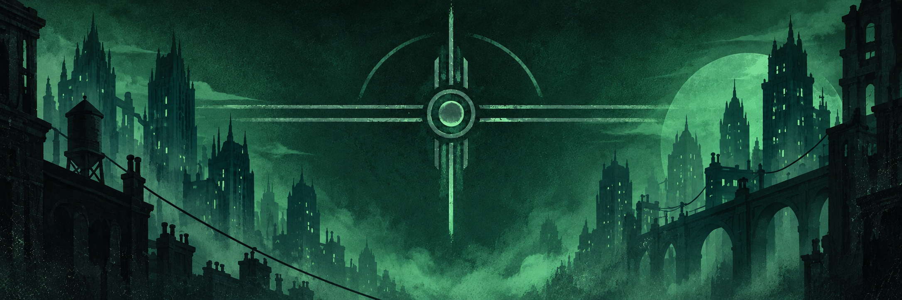
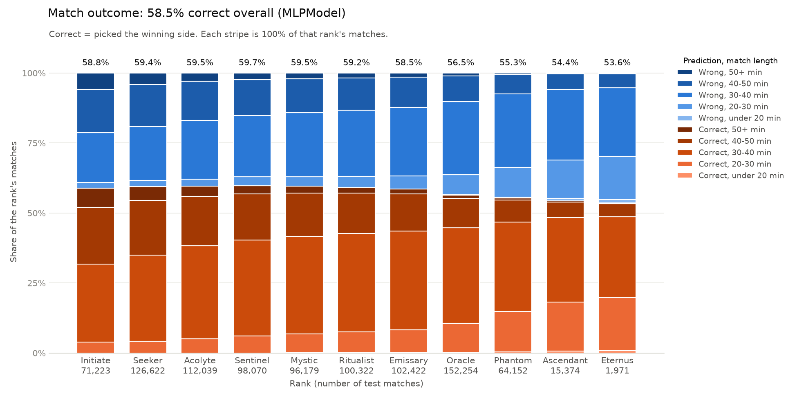
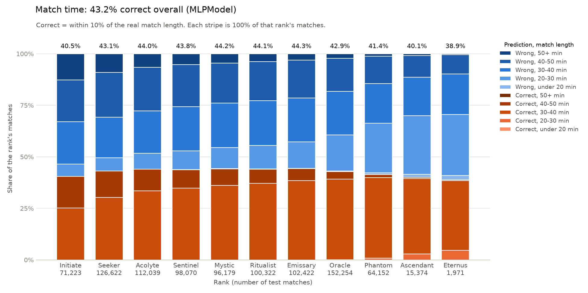
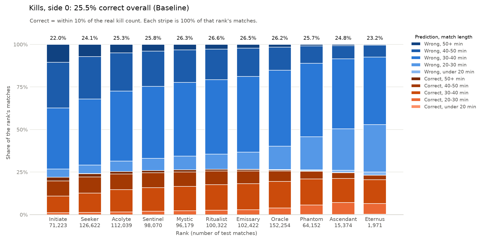
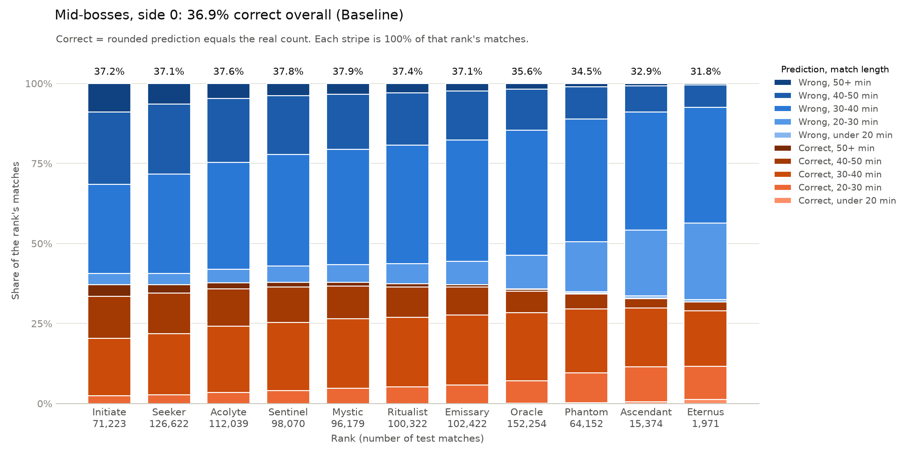

# Deadlock Match Predictor



## Run the project

Use Python 3.12 through 3.14 (tested with 3.14). From the project folder, create a virtual environment, install the dependencies, and run the script.

On Windows PowerShell:

```powershell
python -m venv .venv
.\.venv\Scripts\python.exe -m pip install -r requirements.txt
.\.venv\Scripts\python.exe src/main.py
```

On macOS or Linux:

```bash
python3 -m venv .venv
.venv/bin/python -m pip install -r requirements.txt
.venv/bin/python src/main.py
```

On the first run, the script connects to the Deadlock data lake and DuckDB downloads the extensions it needs. The script estimates the data size and asks before downloading match data. It saves the raw data in `data/players/`, then builds the training dataset in `data/train/` and the ranked test dataset in `data/ranked_test/`. Later runs reuse these datasets when they are already up to date. Once the data is ready, the script trains and tests the models and saves their plots in `results/`.

Training works on a CPU. If you want to use an NVIDIA GPU, install a compatible CUDA build of PyTorch using the [official PyTorch instructions](https://pytorch.org/get-started/locally/).

## What are we trying to predict?

[Deadlock](https://store.steampowered.com/app/1422450/Deadlock/) is a team game with six players on each side. Before a match starts, we know the heroes, lanes, parties, and some information about the players. Can we use that information to predict what will happen?

We try to predict six numbers for each match:

1. Which side wins.
2. How long the match lasts.
3. How many kills each side gets.
4. How many mid-bosses each side claims.

That is four prediction tasks, but six numbers because kills and mid-bosses have one answer for each side.

## Data and constraints

The match data comes from the community [Deadlock API](https://deadlock-api.com/). The saved datasets currently cover **August 1 to September 28, 2026**. They contain **1,727,287 unranked matches** and **940,755 ranked matches**.

We train on all unranked matches and test on ranked matches. This is a deliberate constraint: we want to see how well a model trained in one mode works in the other. The baseline computes its averages from the full unranked dataset. The linear model and four MLPs also train on the full set. This run uses a fixed number of epochs and does not use validation to choose an epoch. Setting a positive `patience` for a learned model switches back to the time-based training and validation split.

Each match has **63 input numbers**, all meant to be known before the match:

| Input group | Numbers | What they mean |
| --- | ---: | --- |
| Hero IDs | 12 | One hero for each player |
| Lanes | 12 | Each player's assigned lane |
| Parties | 12 | Each player's party size |
| Hero experience | 24 | Prior games and prior wins on that hero for each player |
| Match flags | 3 | New-player pool, low-priority pool, and high-skill-range parties |

The six saved outputs are the winner, duration, kills for both sides, and mid-bosses claimed by both sides. We do not use the match's outcome or in-match statistics as inputs.

## Models

There are three implemented approaches. A transformer is a possible future experiment.

### Baseline

The baseline does not learn weights. It looks at the unranked data and finds the side that won more often, the average match length, and the average kills and mid-bosses for each side. It then gives those same predictions for every ranked match.

This gives us a useful reference. A more complex model should improve on it for the task we care about. For mid-bosses, the baseline returns a decimal average; the **test** rounds that prediction to check whether it equals the real count.

### Linear model

The linear model learns an effect for each selected feature. We can turn hero IDs, lanes, parties, experience, and match flags on or off when creating it. Hero IDs, lane codes, and party sizes become counts for each team. Experience becomes the team's total prior games and wins, scaled down by 100. So the learned weights act on these team features, rather than directly on the 63 raw positions.

There are six learned feature-weight vectors: one for winning, one for time, two for kills (kills made and kills given), and two for mid-bosses (taken and given). The model also learns starting values for the six outputs. If flags are enabled, they get their own weights for each output.

For the winner, we compare the two teams' feature vectors. For match length, we use their sum. Kills and mid-boss predictions combine one team's features with the other team's features. This lets the model learn, for example, how a hero affects its own team's kills and how it affects the opponent's kills.

Training adds the win, time, kills, and mid-boss losses, then updates the weights with their gradients. These four tasks use separate weight groups in this model, so their losses do not compete for the same feature weights. The two kill outputs share their kill weights, and the two mid-boss outputs share their mid-boss weights. The model has no hidden nonlinear layers, so it cannot learn every interaction between players.

### MLP

The MLP can learn interactions that the linear model cannot. We use **four separate MLPs**, one for each task. Each one has its own learned hero table and its own layers. The four losses are therefore trained separately. This costs more training time, but a change that helps one task cannot directly change another task's weights.

Here is what happens inside one task MLP:

1. A hero ID looks up **16 learned numbers**. We add **4 lane positions** (including unknown), **7 party-size positions**, and **2 experience counts** (prior games and wins). That gives **29 numbers per player**.
2. The same two layers turn each player's 29 numbers into a **32-number player vector**. ReLU sets negative intermediate values to zero, which lets the model learn patterns that a single linear formula cannot.
3. We add the six player vectors on each side. This gives us **two separate 32-number team vectors**.
4. We put both team vectors and the **3 match flags** together: **32 + 32 + 3 = 67 numbers**. Two more layers turn that into a **32-number matchup vector**. We run those layers with the teams in both orders, so each side gets a matchup view.
5. The final layer turns those matchup vectors into a prediction. The win model uses their difference, the time model uses their sum, and the kills and mid-boss models predict one number per side.

Each task MLP has **four hidden linear layers** in total: two for players and two for the matchup. The hero table is learned too, but it is a lookup table rather than another hidden layer. We convert the win score to a probability and the time prediction from minutes back to seconds when making predictions.

## How we test

After training, the script prints accuracy on the unranked matches used for training and saves it in `training_accuracy.json` inside each model's results folder. These are in-sample scores: they show how well the models predict matches they have already trained on, so they can look better than scores on new matches.

We then use the same separate ranked test matches and rules for every model:

| Prediction | Counted as correct when... |
| --- | --- |
| Winner | The predicted winning side is right |
| Duration | The prediction is within 10% of the real duration |
| Kills, each side | The prediction is within 10% of that side's real kill count |
| Mid-bosses, each side | The rounded prediction equals the real count |

The rules are different, so a 60% winner score and a 40% duration score do not measure the same difficulty.

Each plot shows results by rank. A bar is **100% of the matches in that rank**: orange means correct and blue means wrong. The lighter and darker parts show match-length groups, not confidence. The number under a rank is its match count. The overall percentages on the plots use **940,628 matches with a known rank**; 127 ranked matches have no rank and are left out of these plots.

## Results

These are the current percentages on the ranked test plots. All three approaches use the full unranked dataset for training. The linear model uses all input groups, and the MLP column combines the four independently trained task models.

| Prediction | Baseline | Linear | MLP |
| --- | ---: | ---: | ---: |
| Winner | 50.6% | 58.0% | **58.5%** |
| Duration | 39.2% | **43.2%** | **43.2%** |
| Kills, side 0 | **25.5%** | 20.7% | 22.6% |
| Kills, side 1 | **22.3%** | 20.7% | 22.2% |
| Mid-bosses, side 0 | **36.9%** | 36.6% | 36.7% |
| Mid-bosses, side 1 | **36.5%** | 36.2% | 36.3% |

We also measured accuracy on all **1,727,287 unranked training matches** using the same rules. These numbers show how well each model predicts matches it learned from; the ranked test table above is the better check on new matches.

| Prediction | Baseline training | Linear training | MLP training |
| --- | ---: | ---: | ---: |
| Winner | 50.1% | 61.1% | 63.3% |
| Duration | 40.3% | 40.8% | 41.0% |
| Kills, side 0 | 22.2% | 22.2% | 22.9% |
| Kills, side 1 | 19.9% | 22.3% | 22.8% |
| Mid-bosses, side 0 | 38.1% | 38.5% | 39.2% |
| Mid-bosses, side 1 | 38.0% | 38.4% | 39.1% |

Compared with the earlier 80%-training runs, the MLP's ranked winner score fell from **60.3% to 58.5%**, while its duration score rose from **42.4% to 43.2%**. The other changes are small. The training data and the way we choose the final epoch both changed, so these differences do not tell us which change caused them. The models also use different training settings, and more tuning could change the scores.

### Winner

The independent MLP gets the winner right in **58.5%** of ranked matches with a known rank. That is **7.9 percentage points** above the baseline and **0.5 points** above the all-input linear model. Its training score is **63.3%**. That gap does not measure overfitting by itself, because training uses unranked matches and testing uses ranked matches.



[Baseline winner plot](results/baseline/Baseline_match_outcome.png) | [Linear winner plot](results/linear/id_lanes_parties_experience_flags/LinearModel_match_outcome.png)

### Match duration

The linear model and MLP both score **43.2%** after rounding to one decimal place: their predictions are within 10% of the real match length. The baseline reaches **39.2%**. The MLP improved on its earlier **42.4%** result, but it does not clearly beat the linear model here.



[Baseline duration plot](results/baseline/Baseline_match_time.png) | [Linear duration plot](results/linear/id_lanes_parties_experience_flags/LinearModel_match_time.png)

### Kills

Kills are harder under the 10% rule. For side 0, the baseline scores **25.5%**, the MLP **22.6%**, and the all-input linear model **20.7%**. For side 1, they score **22.3%**, **22.2%**, and **20.7%**, respectively. The MLP improves on the linear model, but it does not beat the baseline here.



[Linear side 0 kills plot](results/linear/id_lanes_parties_experience_flags/LinearModel_kills_side_0.png) | [MLP side 0 kills plot](results/mlp/independent/MLPModel_kills_side_0.png)

### Mid-bosses

The baseline scores **36.9%** for side 0 and **36.5%** for side 1. The MLP is close at **36.7%** and **36.3%**; the linear model gets **36.6%** and **36.2%**. The baseline's average is about **0.9 mid-bosses per side**, which rounds to one. One mid-boss is common in the ranked data, so this simple prediction is already hard to improve on under the exact-count rule.



[Linear side 0 mid-boss plot](results/linear/id_lanes_parties_experience_flags/LinearModel_mid-bosses_side_0.png) | [MLP side 0 mid-boss plot](results/mlp/independent/MLPModel_mid-bosses_side_0.png)

The highest ranks have fewer test matches, so their percentages will move more with each additional correct or wrong prediction. All six plots for every saved run are in [`results/`](results/).

## Next steps

- [ ] Try building a transformer.
- [ ] Automate the data pipeline.
- [ ] Improve duration, kills, and mid-boss predictions.
- [ ] Tune the MLPs and check whether the gains hold on new matches.
